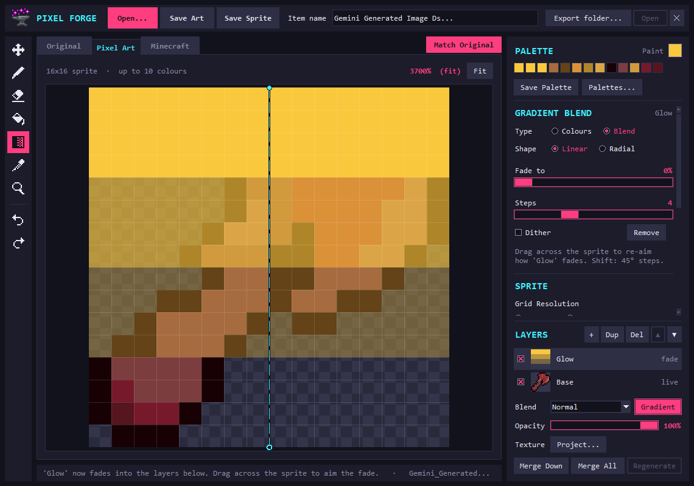

# Pixel Forge

An offline desktop app that turns a picture into a 16x16 or 32x32 pixel-art
sprite and lets you edit it with layers. It's made for Minecraft item and block
textures, and it works for any small sprite.

Everything runs on your own PC: no account, no API key, no internet after setup.



## What it does

**Convert a picture**

- Finds the subject and removes the background: a plain background by its colour,
  a busy one with an optional AI model that also runs offline.
- Limits the palette (2 to 64 colours), cleans up stray pixels, and draws an outline and
  detail lines so the result reads as pixel art, not a blurred photo.
- Scale and move the subject inside the grid. **Match Original** re-fits the colours to
  the source.
- A Minecraft tab shows the sprite as an item in an inventory.

**Edit it**

- Pen, Eraser, Fill, Picker, Move and Zoom tools. Zoom goes from actual size up to 128x.
- Up to 8 layers with blend modes (Multiply, Overlay, Soft Light…), opacity, merge and
  undo/redo.
- **Gradients:** a Gradient tool for editable gradient layers (linear or radial, stepped
  bands, dithering). A layer can also fade into the ones below along a gradient.
- **Grayscale layers:** set a layer's Blend to Grayscale and everything beneath its
  pixels turns grey.
- **Texture projection:** open a texture image and it fills whatever is drawn on a layer.
- **Palette library:** save a sprite's colours and reuse them in any other project, to
  paint with or to recolour a layer.
- **Open as-is:** pixel art that's already the right size opens pixel for pixel, with no
  conversion.

Anything that takes more than a moment shows a progress bar saying what it's doing.

## Getting started (Windows)

You need [Python](https://www.python.org/downloads/) 3.10 or newer, installed with
"Add to PATH" and "tcl/tk" ticked.

1. Download or clone this repository.
2. Double-click **`start.bat`**. The first run sets up a private Python environment in
   the folder and installs [Pillow](https://python-pillow.org) (this needs internet once).
   After that the app opens straight away.

Optional extras:

- **AI background removal:** run `install-ai.bat` once. It downloads about 360 MB of
  packages and a 179 MB model, then works offline.
- **A real launcher:** run `build-launcher.bat` to build `Pixel Forge.exe` with its own
  icon. You can pin it to the taskbar or move it to the Desktop. Run the script again if
  you move the app folder.
- **Web version:** `start-web.bat` runs a simpler converter in your browser (Streamlit).

## Steam Deck and Linux

The Linux version is one file with everything it runs on inside it: Python, the window
toolkit, the image library and its font. Nothing else has to be installed, and nothing is
installed system-wide, so SteamOS updates don't remove it.

### Install from Konsole

This repository is private, so the download needs a GitHub token that can read it.

**Once: make a token.** On github.com (the Deck's browser works), signed in as the
repository's owner:

1. Profile picture → **Settings** → **Developer settings** → **Personal access tokens** →
   **Fine-grained tokens** → **Generate new token**.
2. Give it a name and an expiry date. Under **Repository access** choose **Only select
   repositories** and pick **Pixel-Forge**.
3. Under **Permissions → Repository permissions**, set **Contents** to **Read-only**.
4. **Generate token** and copy it (it starts with `github_pat_`). It can only read this
   one repository.

**Then, in Desktop Mode, open Konsole and paste these two commands** (Ctrl+Shift+V
pastes). The first asks for the token; what you paste stays hidden:

```
read -rsp "GitHub token: " PF_TOKEN; echo
```

```
curl -fsSL -H "Authorization: Bearer $PF_TOKEN" -H "Accept: application/vnd.github.raw" https://api.github.com/repos/omegaRift/Pixel-Forge/contents/install.sh | PF_TOKEN="$PF_TOKEN" bash
```

That downloads the newest release into `~/.local/share/PixelForge`, and adds **Pixel Forge**
to the desktop and to the application menu (under Graphics). The token is only used for
the download and is never saved.

- **Update:** run the same two commands again.
- **Remove:** `bash ~/.local/share/PixelForge/install.sh --uninstall` (your settings and
  palettes are kept).
- **Gaming Mode:** in Desktop Mode open Steam, choose **Games → Add a Non-Steam Game to My
  Library**, and tick Pixel Forge. The window fits the Deck's 1280x800 screen. The trackpad
  moves the pointer, and Steam + X brings up the keyboard for names.

### Or by hand

Download `PixelForge-linux-x86_64` from this repository's **Releases** page in the browser,
then either run `PF_FILE=~/Downloads/PixelForge-linux-x86_64 bash install.sh` with a copy
of [install.sh](install.sh), or just mark the file as executable (in Dolphin: right-click
→ **Properties → Permissions → Is executable**) and double-click it.

Differences from the Windows version:

- AI background removal isn't included (plain removal is).
- Settings and the palette library are in `~/.config/PixelForge`.
- Opening Pixel Forge from Grass Block is Windows-only.

On any Linux PC you can also run it from source. It needs Python 3.10+ with Tk
(`python3-tk` on Debian and Ubuntu, `tk` on Arch):

```
python3 -m venv .venv
.venv/bin/pip install -r requirements.txt
.venv/bin/python pixel_forge.py
```

## Using it

1. **Open…** a picture (PNG or JPEG). A small square picture can be opened as it is
   instead of converted.
2. Adjust the conversion in the right sidebar: grid size, colours, outline, background.
3. Pick a tool on the left to edit. Layers are at the bottom of the sidebar.
4. **Save Sprite** saves the sprite at its real size (for example `flesh_axe.png`, 16x16).
   **Save Art** saves an enlarged 512 px copy. Set an export folder in the top bar to save
   without being asked where.

| Keys | |
|---|---|
| Ctrl+O / Ctrl+Shift+O | Open a picture / open pixel art as it is |
| Ctrl+S / Ctrl+Shift+S | Save Art / Save Sprite |
| Ctrl+Z / Ctrl+Y | Undo / redo |
| M, B, E, G, Shift+G, I, Z | Move, Pen, Eraser, Fill, Gradient, Picker, Zoom |
| Mouse wheel, middle-drag | Zoom, pan |
| Ctrl+wheel, Ctrl+arrows, Ctrl+0 | Scale, nudge, reset the subject (Move tool) |
| Ctrl+M | Match Original |
| X | Swap the gradient's colours (Gradient tool) |

Hover over any control for a tooltip.

Pixel Forge keeps its settings and your palette library in `%APPDATA%\PixelForge`
(`settings.json` and `palettes.db`).

## Use from another app

Another program can open Pixel Forge on one texture and get the result back, the way the
Grass Block mod editor does: it starts `Pixel Forge.exe --edit <texture.png>`, waits for
the window to close, and reads an exit code and a small result file.
[docs/INTEGRATION.md](docs/INTEGRATION.md) is the whole contract.

## Tests

```
.venv\Scripts\python tests\run_all.py
```

This runs every suite, then a layout check, and takes about three minutes. Add a word to
run only matching suites, for example `tests\run_all.py gradient`.

- The suites that drive the real window use an invisible one, so nothing appears on screen
  and your mouse and keyboard aren't touched.
- They use scratch settings in your temp folder, never your own.
- Two suites need the built `Pixel Forge.exe` and are skipped without it. The AI checks are
  skipped unless the AI extras are installed.

## What's where

| | |
|---|---|
| `pixel_forge.py` | The app window: converter controls, tabs, saving |
| `pixel_core.py` | The picture-to-sprite conversion (no UI) |
| `layers.py` | Layers, blend modes, gradients, projection, compositing, undo (no UI) |
| `editor_ui.py`, `gradient_ui.py`, `projection_ui.py`, `palette_ui.py` | The editor's tools and panels |
| `palette_store.py` | The palette library (SQLite) |
| `edit_session.py` | Being opened by another app (`--edit`), and opening as-is |
| `waitbar.py`, `ui_widgets.py`, `mc_preview.py` | Progress bars, small widgets, the Minecraft preview |
| `launcher.cs` | Source of `Pixel Forge.exe` |
| `app.py` | The Streamlit web version |
| `tests/` | The test suites and their runner |
| `docs/` | The integration contract and design notes. The UI Guide and its screenshots predate the current layout |
